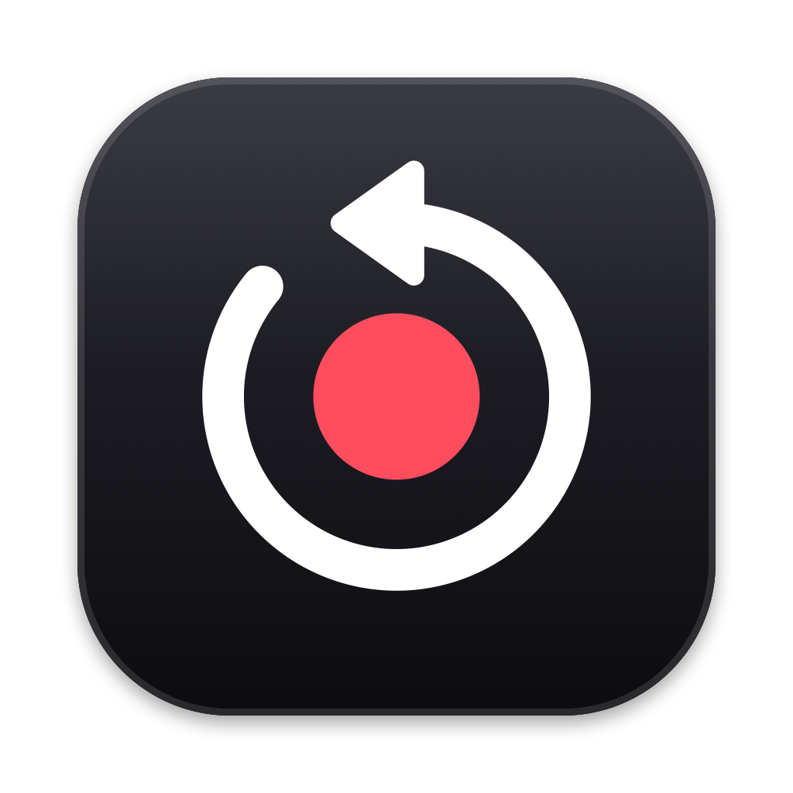
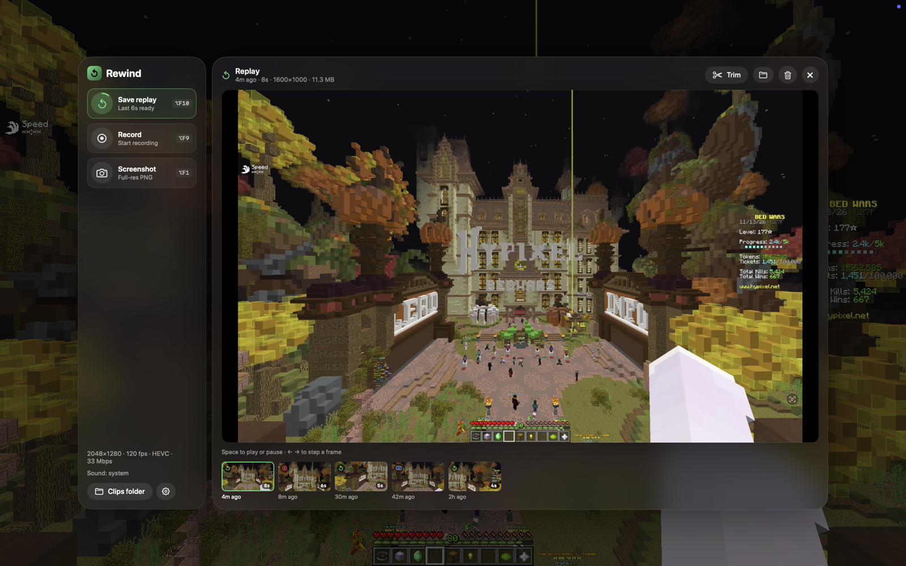
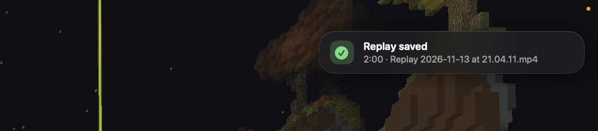
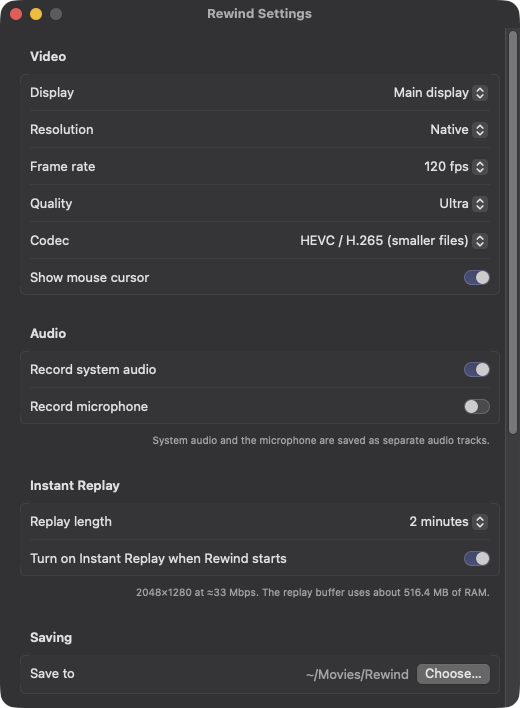

# Rewind

A ShadowPlay-style screen recorder for macOS. Rewind keeps the last few minutes of your screen in memory so you can save a clip **after** something cool happens, and it can also do regular recordings and screenshots. It's inspired by [gpu-screen-recorder](https://git.dec05eba.com/gpu-screen-recorder/about/) and its UI on Linux.



## Features

- **Automatic updates.** Rewind checks for new versions and installs them itself when you click the notice.
- **Instant Replay.** Keeps the last 15 seconds to 20 minutes ready to save with one hotkey. Clips are written without re-encoding, so saving is near-instant.
- **Recording.** Start/stop a normal recording at any time; it runs alongside Instant Replay.
- **Screenshots.** Full-resolution PNG of the display.
- **Pick a screen or an app.** In Settings → Capture, choose Display 1, Display 2 (and so on), or one app.
- **Capture one app.** Choose an app (a game, say), and only its windows and sound are recorded, so notifications and other apps stay out of your clips. If the app isn't running, Rewind records the fallback display and switches over automatically when the app opens. Clips of that app are named after it, like `Roblox 2026-11-13 at 16.53.58.mp4`.
- **Hardware encoding.** Captures with ScreenCaptureKit and encodes H.264 or HEVC on the Apple media engine, so it's light on the CPU and GPU while you play.
- **Audio.** System audio and/or microphone. By default your mic is mixed into the main track so clips play correctly everywhere; turn that off to keep them as separate tracks for editing.
- **Auto-cleanup** (optional, off by default). Moves clips and screenshots older than a set number of days (14 by default) to the Trash. Only Rewind's own files are touched.
- **Preview clips in the overlay.** Your newest clip is loaded in the overlay's player as soon as it opens, with the latest clips and screenshots as thumbnails under it. Click one to play it right in the overlay (Space plays or pauses, ← → step a frame), show it in Finder, or move it to the Trash. Clicking a "saved" notice opens the clip there too.
- **In-game overlay** (⌥Z) with three layouts: **Classic** (ShadowPlay-style), **Tiles** (big buttons with your clips below) and **Split** (actions beside a player showing your newest clip). Pick the accent color from presets or the color wheel in Settings → Overlay. Works over fullscreen apps. Rewind's own windows never appear in your clips.
- **Global hotkeys** that work while a game has focus, and can be changed in Settings.

<p>
  
</p>

## Hotkeys

| Default | Action |
|---|---|
| ⌥Z | Show / hide the overlay |
| ⌥F10 | Save instant replay |
| ⌥⇧F10 | Turn instant replay on / off |
| ⌥F9 | Start / stop recording |
| ⌥F1 | Take a screenshot |

On a Mac keyboard you may need to hold **fn** for the F-keys.

To change a hotkey, click it in Settings and press the new keys. Press **Esc** instead to remove it (it shows "No bind set").

In the overlay, **left-click** Instant Replay to save a clip and **right-click** it to turn replay off. Record and Screenshot work with either mouse button.

## Install

1. Download `Rewind-<version>-macOS.dmg` from [Releases](../../releases) and open it.
2. Drag **Rewind** onto the **Applications** shortcut, then eject the disk image.
3. The app isn't notarized, so the first time, **right-click Rewind.app → Open → Open**. If macOS still blocks it, go to System Settings → Privacy & Security and click **Open Anyway**.
4. Allow **Screen & System Audio Recording** when asked, then quit and reopen Rewind (see below).

Requires macOS 15 Sequoia or later, on Apple Silicon or Intel.

### Updates

Rewind checks GitHub for a new version when it starts (turn this off in Settings → Updates). If there is one, a notice stays up for about a minute and a half: click it to update, or click ✕ to skip. You can also check any time with **Check for Updates** at the bottom of Settings.

Updating downloads the release's .dmg into a temporary folder, opens it out of sight, checks the app inside is signed with the same certificate as your copy (anything else is refused), swaps the app and reopens it. You don't need to download, mount or eject anything yourself. Rewind needs to be in a folder it can write to, like Applications.

Your version number is in the title of the Settings window and under Settings → Updates.

### Permissions

Most of these are in **System Settings → Privacy & Security**. macOS asks for each one the first time Rewind needs it.

| Permission | Needed? | What it's for |
|---|---|---|
| **Screen & System Audio Recording** | Required | Recording your screen and system sound, and taking screenshots. Turn Rewind on in the list, then quit and reopen Rewind; macOS only applies it after a restart. |
| **Microphone** | Only if you turn on "Record microphone" | Recording your voice into clips. |
| **Login Items** | Only if you turn on "Open Rewind at login" | Listed under System Settings → General → Login Items. |
| **Files and Folders** | Only if you save clips to Desktop, Documents or Downloads | The default folder, `~/Movies/Rewind`, doesn't need it. |

Rewind doesn't need Accessibility or Input Monitoring: its hotkeys use the system's global hotkey service, which needs no permission.

If clips come out black or silent after an update, remove Rewind from the Screen & System Audio Recording list, add it again, and reopen Rewind. An unnotarized app's permission can reset when the app is replaced.

Clips are saved to `~/Movies/Rewind` by default.

### Uninstall

Settings → **Uninstall Rewind…** (at the very bottom) permanently deletes everything Rewind put on your Mac except your clips. It shows you the list first, and once you confirm it does this by itself:

| Trace | What happens to it |
|---|---|
| Rewind.app (the copy you're running) | Deleted |
| Other copies of Rewind (e.g. an older one in Downloads) | Deleted |
| Downloaded installers in Downloads or on the Desktop (`Rewind-<version>-macOS.dmg` / `.zip`) | Deleted |
| Settings (`~/Library/Preferences/local.rewind.recorder.plist`) | Deleted |
| Caches from update checks (`~/Library/Caches/local.rewind.recorder`, `~/Library/HTTPStorages/local.rewind.recorder`) | Deleted |
| Leftover update downloads in the temporary folder | Deleted |
| Screen & System Audio Recording and Microphone permissions | Reset (Rewind disappears from those lists) |
| "Open Rewind at login" | Removed from Login Items |
| **Your clips** (`~/Movies/Rewind` or the folder you chose) | **Kept** |

A recording in progress is saved first. Deleting is permanent (nothing goes to the Trash), so to use Rewind again you'd download it again; your clips are untouched either way.

macOS lets an app delete itself, but it can stop it from deleting *other* apps (its App Management protection). If an older copy of Rewind can't be deleted, Rewind selects it in Finder and tells you, so you can drag it to the Trash yourself.

## Settings



Choose what to capture (any connected display, or one app), resolution, frame rate (30/60/120), quality, codec, replay length, audio sources and whether to mix the mic in, save folder, auto-cleanup of old clips, hotkeys, and whether Rewind opens at login. The Settings window shows how much RAM the replay buffer will use.

## Build from source

Requires Xcode 16 or later.

```bash
./build.sh            # builds build/Rewind.app for this Mac
./release.sh 1.6.0    # universal, signed .dmg in dist/ (also what the updater downloads)
```

`release.sh` signs the app and the .dmg with a code-signing certificate named "Rewind Release" in the login keychain (not in this repo). The updater only installs apps signed with that same certificate, and keeping it means macOS keeps Rewind's Screen Recording permission across updates.

`build.sh` signs with the "Rewind Release" certificate if it's in your keychain, otherwise an Apple Development certificate, so the permission survives rebuilds. Set `SIGN_IDENTITY=-` to sign ad-hoc instead.

To check the capture → encode → replay → MP4 pipeline without screen permission:

```bash
.build/release/Rewind --selftest /tmp/rewind-test
```

### Changing the look

The layout, accent color, dimming and hotkey hints are in Settings → Overlay. Size, roundness, opacity and text live in [`Sources/Rewind/Theme.swift`](Sources/Rewind/Theme.swift).

## Known limitations

- Saved replays can be up to 1 second longer than the set length, because clips have to start on a keyframe.
- With "Mix microphone into the main track" turned off, system audio and mic are separate tracks. QuickTime and video editors use both; VLC, browsers, Discord and most phones play only the first (system audio).
- When nothing on screen changes, macOS sends no new frames, so the video holds the last frame instead of keeping a constant frame rate.
- Opening the overlay takes focus from the game, so games that pause on focus loss (like Minecraft) will pause.

## License

[MIT](LICENSE)
