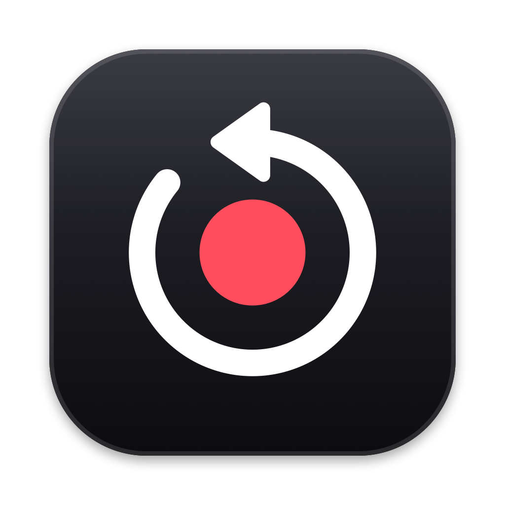
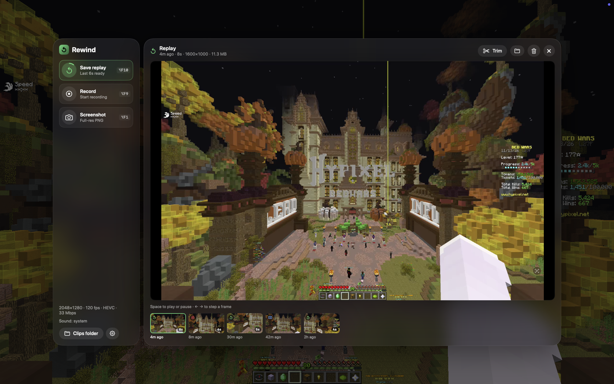
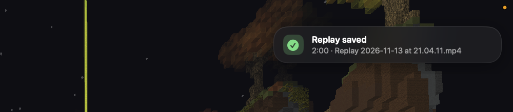
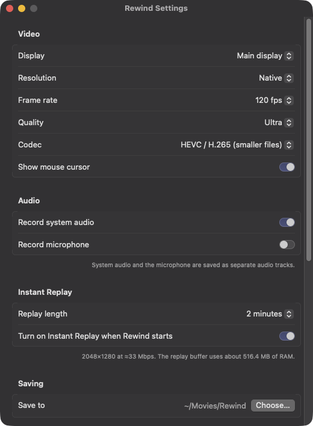

# Rewind

A ShadowPlay-style screen recorder for macOS. Rewind keeps the last few minutes of your screen in memory so you can save a clip **after** something cool happens, and it can also do regular recordings and screenshots. It's inspired by [gpu-screen-recorder](https://git.dec05eba.com/gpu-screen-recorder/about/) and its UI on Linux.



## Features

- **Instant Replay.** Keeps the last 15 seconds to 20 minutes ready to save with one hotkey. Clips are written without re-encoding, so saving is near-instant.
- **Recording.** Start/stop a normal recording at any time; it runs alongside Instant Replay.
- **Screenshots.** Full-resolution PNG of the display.
- **Capture one app.** Choose an app (a game, say) in Settings, and only its windows and sound are recorded, so notifications and other apps stay out of your clips. If the app isn't running, Rewind records the whole display and switches over automatically when the app opens. Clips of that app are named after it, like `Roblox 2026-11-13 at 16.53.58.mp4`.
- **Hardware encoding.** Captures with ScreenCaptureKit and encodes H.264 or HEVC on the Apple media engine, so it's light on the CPU and GPU while you play.
- **Audio.** System audio and/or microphone. By default your mic is mixed into the main track so clips play correctly everywhere; turn that off to keep them as separate tracks for editing.
- **Auto-cleanup** (optional, off by default). Moves clips and screenshots older than a set number of days (14 by default) to the Trash. Only Rewind's own files are touched.
- **Preview clips in the overlay.** Your newest clip is loaded in the overlay's player as soon as it opens, with the latest clips and screenshots as thumbnails under it. Click one to play it right in the overlay (Space plays or pauses, ← → step a frame), show it in Finder, or move it to the Trash. Clicking a "saved" notice opens the clip there too.
- **In-game overlay** (⌥Z) with two layouts: two panes (actions beside a player showing your newest clip) or a Classic ShadowPlay-style bar with a Gallery drop-down. Pick the accent color from presets or the color wheel in Settings → Overlay. Works over fullscreen apps. Rewind's own windows never appear in your clips.
- **Global hotkeys** that work while a game has focus, and can be changed in Settings.

<p>
  
</p>

## Hotkeys

| Default | Action |
|---|---|
| ⌥Z | Show / hide the overlay |
| ⌥F10 | Save instant replay |
| ⌥⇧F10 | Turn instant replay on / off |
| ⌥F9 | Start / stop recording |
| ⌥F1 | Take a screenshot |

On a Mac keyboard you may need to hold **fn** for the F-keys.

To change a hotkey, click it in Settings and press the new keys. Press **Esc** instead to remove it (it shows "No bind set").

In the overlay, **left-click** Instant Replay to save a clip and **right-click** it to turn replay off. Record and Screenshot work with either mouse button.

## Install

1. Download `Rewind-<version>-macOS.zip` from [Releases](../../releases) and unzip it.
2. Move **Rewind.app** to `/Applications`.
3. The app isn't notarized, so the first time, **right-click Rewind.app → Open → Open**. If macOS still blocks it, go to System Settings → Privacy & Security and click **Open Anyway**.
4. Allow **Screen Recording** when asked (System Settings → Privacy & Security → Screen Recording), then quit and reopen Rewind.

Requires macOS 15 Sequoia or later, on Apple Silicon or Intel.

Clips are saved to `~/Movies/Rewind` by default.

## Settings



Choose what to capture (the whole display or one app), the display, resolution, frame rate (30/60/120), quality, codec, replay length, audio sources and whether to mix the mic in, save folder, auto-cleanup of old clips, hotkeys, and whether Rewind opens at login. The Settings window shows how much RAM the replay buffer will use.

## Build from source

Requires Xcode 16 or later.

```bash
./build.sh            # builds build/Rewind.app for this Mac
./release.sh 1.0.0    # universal, ad-hoc signed zip in dist/
```

`build.sh` signs with your Apple Development certificate if you have one, so the Screen Recording permission survives rebuilds. Set `SIGN_IDENTITY=-` to sign ad-hoc instead.

To check the capture → encode → replay → MP4 pipeline without screen permission:

```bash
.build/release/Rewind --selftest /tmp/rewind-test
```

### Changing the look

The layout, accent color, dimming and hotkey hints are in Settings → Overlay. Size, roundness, opacity and text live in [`Sources/Rewind/Theme.swift`](Sources/Rewind/Theme.swift).

## Known limitations

- Saved replays can be up to 1 second longer than the set length, because clips have to start on a keyframe.
- With "Mix microphone into the main track" turned off, system audio and mic are separate tracks. QuickTime and video editors use both; VLC, browsers, Discord and most phones play only the first (system audio).
- When nothing on screen changes, macOS sends no new frames, so the video holds the last frame instead of keeping a constant frame rate.
- Opening the overlay takes focus from the game, so games that pause on focus loss (like Minecraft) will pause.

## License

[MIT](LICENSE)
