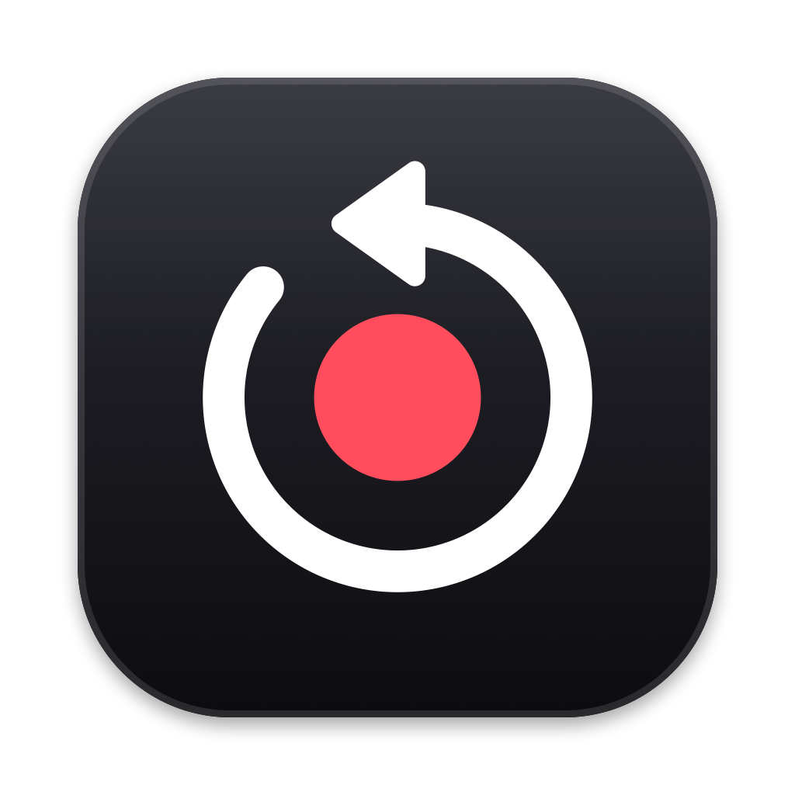
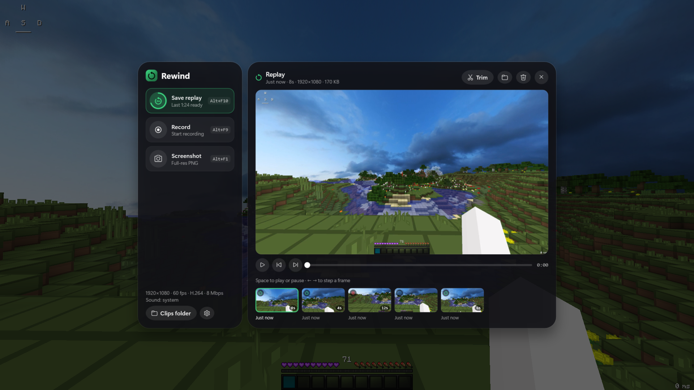
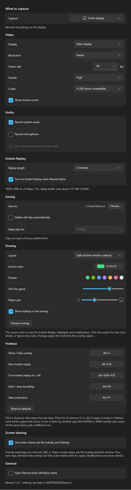

# Rewind for Windows

The Windows port of [Rewind](../README.md), the ShadowPlay-style screen recorder. Rewind keeps the last few minutes of your screen in memory so you can save a clip **after** something cool happens, and it can also do regular recordings and screenshots. It has the same features, overlay, hotkeys and settings as the macOS app, rebuilt on Windows' own capture and encoding APIs.



## Features

- **Instant Replay.** Keeps the last 15 seconds to 20 minutes ready to save with one hotkey. Clips are written without re-encoding, so saving is near-instant.
- **Recording.** Start/stop a normal recording at any time; it runs alongside Instant Replay.
- **Screenshots.** Full-resolution PNG of the display.
- **Capture one app.** Choose an app (a game, say) in Settings, and only its window and sound are recorded, so notifications and other apps stay out of your clips. If the app isn't running, Rewind records the whole display and switches over automatically when the app opens. Clips of that app are named after it, like `Roblox 2026-11-13 at 16.53.58.mp4`. Games that run inside Java, Python or Electron are named from their window title, so Minecraft clips say Minecraft rather than Java.
- **Hardware encoding.** Captures with Windows.Graphics.Capture and encodes H.264 or HEVC on the GPU (NVIDIA NVENC, Intel Quick Sync or AMD AMF), so it's light on the CPU while you play.
- **Audio.** System audio and/or microphone. By default your mic is mixed into the main track so clips play correctly everywhere; turn that off to keep them as separate tracks for editing.
- **Auto-cleanup** (optional, off by default). Moves clips and screenshots older than a set number of days (14 by default) to the Recycle Bin. Only Rewind's own files are touched.
- **Preview and trim clips in the overlay.** Your latest clips and screenshots show as thumbnails under the tiles. Click one to play it right in the overlay (Space plays or pauses, ← → step a frame), trim it, show it in Explorer, or move it to the Recycle Bin. Clicking a "saved" notification opens the clip there too. Trimming saves a new file next to the original (`… (trimmed).mp4`) without re-encoding, so it's instant and loses no quality.
- **In-game overlay** (Alt+Z). Works over borderless/windowed fullscreen games, and frees the mouse pointer that games hide and lock. Friends watching your Discord or OBS screen share can see it, but it never appears in your own clips.
- **Global hotkeys** that work while a game has focus, and can be changed in Settings.

## Hotkeys

| Default | Action |
|---|---|
| Alt+Z | Show / hide the overlay |
| Alt+F10 | Save instant replay |
| Alt+Shift+F10 | Turn instant replay on / off |
| Alt+F9 | Start / stop recording |
| Alt+F1 | Take a screenshot |

These are the same keys as NVIDIA ShadowPlay. If the NVIDIA or AMD overlay is running, it already owns some of them; Rewind tells you which ones are taken, and you can pick others in Settings.

To change a hotkey, click it in Settings and press the new keys. Press **Esc** instead to remove it (it shows "No bind set").

In the overlay, **left-click** Instant Replay to save a clip and **right-click** it to turn replay off. Record and Screenshot work with either mouse button.

Rewind lives in the notification area (system tray). Click its icon for the menu.

## Install

1. Download `Rewind-<version>-Windows-x64.zip` (or `-arm64` for ARM PCs) from [Releases](../../../releases) and unzip it anywhere.
2. Run **Rewind.exe**. The app isn't code-signed, so the first time Windows SmartScreen may say it protected your PC: click **More info → Run anyway**.

No permissions are needed for screen capture. To record your microphone, desktop apps must be allowed to use it (Settings → Privacy & security → Microphone); Rewind tells you if they aren't.

Requires Windows 10 version 2004 (build 19041) or later, or Windows 11, on x64 or ARM64. Hardware encoding needs a GPU with a video encoder (practically every NVIDIA, AMD and Intel GPU from the last ten years); without one Rewind falls back to Windows' software H.264 encoder.

Clips are saved to `Videos\Rewind` by default.

## Settings



Choose what to capture (the whole display or one app), the display, resolution, frame rate (pick one or type any from 1 to 360 fps), quality, codec, replay length, audio sources and whether to mix the mic in, save folder, auto-cleanup of old clips, hotkeys, whether screen shares can see the overlay and Settings, and whether Rewind opens when Windows starts. The Settings window shows how much RAM the replay buffer will use.

While the overlay is open over a whole-display capture that screen shares can see, Rewind's own video holds its last frame (sound keeps recording), so the overlay stays out of your clips. Notifications are always hidden from every capture.

Settings are stored in `%APPDATA%\Rewind\settings.json`. A diagnostics log is kept in `%LOCALAPPDATA%\Rewind\rewind.log`.

## Build from source

Requires the [.NET 10 SDK](https://dotnet.microsoft.com/download). Nothing else: no Visual Studio, Windows SDK or C++ toolchain.

```powershell
.\build.ps1              # builds build\Rewind.exe for this PC (needs the .NET 10 Desktop Runtime)
.\build.ps1 -SelfTest    # ...and runs the pipeline self-test
.\release.ps1 1.3.0      # self-contained single-file x64 + ARM64 zips in dist\
```

Or simply `dotnet run` from this folder.

To check the capture → encode → replay → MP4 pipeline without recording the screen (it drives the GPU colour converter and hardware encoder with synthetic frames and audio, writes clips and recordings, then decodes them and measures A/V sync):

```powershell
.\build\Rewind.exe --selftest $env:TEMP\rewind-test
```

To redraw the Windows icon from [`docs/icon.png`](../docs/icon.png):

```powershell
.\scripts\make-icon.ps1
```

### Developer tools

| Flag | What it does |
|---|---|
| `--selftest <dir>` | Pipeline self-test (see above). |
| `--bench [seconds]` | Measures what Instant Replay costs (CPU, GPU engines, wake-ups, RAM, MB/min) while recording an animated test window with fixed settings, then times saving a clip. Add `--fps 30`, `--desktop` or `--use-settings` to vary it. |
| `--action <name>` | Tells the running Rewind to `save-replay`, `toggle-replay`, `toggle-recording`, `screenshot`, `toggle-overlay`, `settings` or `quit`. Handy for scripts and stream decks. |
| `--render-ui <dir>` | Draws the overlay, a notification and the Settings window to PNGs. Add `--background <image>` to draw the overlay over a game screenshot, and `--clips <folder>` to fill its recent clips from that folder (and draw a preview of the newest). |
| `--probe-capture` | Counts frames from the primary display for two seconds, to diagnose capture problems. Saves nothing. |
| `--probe-player <clip>` | Plays a clip muted, without a window, through the overlay's player, then seeks and steps a frame, to check playback works. |
| `--probe-audio` | Listens to system audio for two seconds and reports whether Rewind's own sound is left out and how loud it was. Plays nothing. |
| `--probe-overlay-cursor` | Opens the overlay over a stand-in game that hides and locks the mouse pointer, and checks a pointer is usable. |
| `--quality-test [dir]` | Encodes the same synthetic game and desktop footage with different encoder settings and reports size against quality (PSNR, SSIM, worst frame). |
| `--inspect <file>` | Shows what Windows' media stack sees in a clip: tracks, decoded frames, durations. |
| `--settings`, `--overlay`, `--demo-toast` | Open those at launch, like the macOS app's flags. |
| `--capturable` | Don't hide Rewind's own windows from capture (for screenshots of the UI). |

### Changing the look

Overlay colors, size, roundness, opacity and text live in [`src/Theme.cs`](src/Theme.cs), with the same names and values as the macOS [`Theme.swift`](../Sources/Rewind/Theme.swift) (the panel is a little more opaque, because Windows can't blur behind it). The values exported by the interactive designer at [`design/overlay-mockup.html`](../design/overlay-mockup.html) carry over to either file.

## How it maps to the macOS app

The files mirror `Sources/Rewind/` one to one, so a change on one side is easy to carry over.

| macOS | Windows | File |
|---|---|---|
| ScreenCaptureKit | Windows.Graphics.Capture (display or window), `SetWindowDisplayAffinity` to hide Rewind's own windows | `CaptureEngine.cs`, `Gpu.cs` |
| VideoToolbox (Apple media engine) | Media Foundation hardware encoder MFT, fed NV12 surfaces converted on the GPU by the D3D11 video processor | `VideoEncoder.cs`, `Gpu.cs` |
| ScreenCaptureKit audio | WASAPI loopback, microphone, and per-process loopback for "capture one app" | `AudioCapture.cs` |
| AVAssetWriter | A small built-in MP4 muxer (H.264/HEVC passed through, AAC from Media Foundation's encoder) | `Mp4Muxer.cs`, `Writers.cs` |
| AVAssetReaderAudioMixOutput mixdown | The mic is mixed in while writing, so there's no second pass | `AudioMixdown.cs` |
| Carbon `RegisterEventHotKey` | `RegisterHotKey` | `Hotkeys.cs` |
| Menu bar item | Notification-area icon | `App.cs` |
| SwiftUI overlay, toasts, settings | WPF (settings use the Windows 11 Fluent theme) | `Overlay.cs`, `Toast.cs`, `SettingsWindow.cs` |
| `UserDefaults`, `SMAppService` | JSON file, `HKCU\…\Run` | `Settings.cs`, `SettingsWindow.cs` |
| Replay buffer, controller, auto-cleanup | Same logic, ported line for line | `ReplayBuffer.cs`, `Controller.cs`, `Cleanup.cs` |
| AVPlayer preview, AVAssetExportSession passthrough trim, QuickLook thumbnails | Media Foundation's Media Engine drawing into a WPF bitmap, a passthrough trimmer on the built-in MP4 reader and muxer, Explorer's thumbnails | `Clips.cs`, `ClipPlayer.cs`, `Mp4Reader.cs` |

## Known limitations

- Saved replays can be up to 2 seconds longer than the set length, because clips have to start on a keyframe. Keyframes come every 2 seconds (1 on macOS) because that makes files smaller at the same quality.
- A trimmed clip has to begin on a keyframe, so the file also holds up to 2 seconds from before the cut, and an MP4 edit list says where the clip really starts. Rewind's preview and players that read edit lists (VLC, ffmpeg-based apps, video editors) start exactly at the cut. Windows' Photos and Media Player apps ignore it and play those extra seconds first.
- The overlay's player uses Windows' own codecs, so HEVC clips only play there if the HEVC Video Extensions are installed (the same as for the Photos and Media Player apps). While a game is busy with the GPU, HEVC previews can stutter; the clips themselves are fine.
- When nothing on screen changes, Windows sends no new frames, so the video holds the last frame instead of keeping a constant frame rate.
- Opening the overlay takes focus from the game, so games that pause on focus loss will pause.
- The overlay and notifications can't draw over games in *exclusive* fullscreen; use borderless or windowed fullscreen (most games default to it now). Capture itself works either way.
- "Capture one app" records the app's largest window. On Windows 11 24H2 its menus and pop-ups are included; on older versions they aren't. A minimized window records nothing new until it's restored.
- On Windows 10, Windows draws a yellow border around whatever is being captured. Windows 11 lets Rewind hide it.
- With "Mix microphone into the main track" turned off, system audio and mic are separate tracks. Video editors use both; VLC, browsers and Discord play the first (system audio), while Windows' own Media Player plays the last one (the mic).
- Protected video (DRM, e.g. some streaming sites) records as black, as with every Windows capture tool.

## License

[MIT](../LICENSE)
